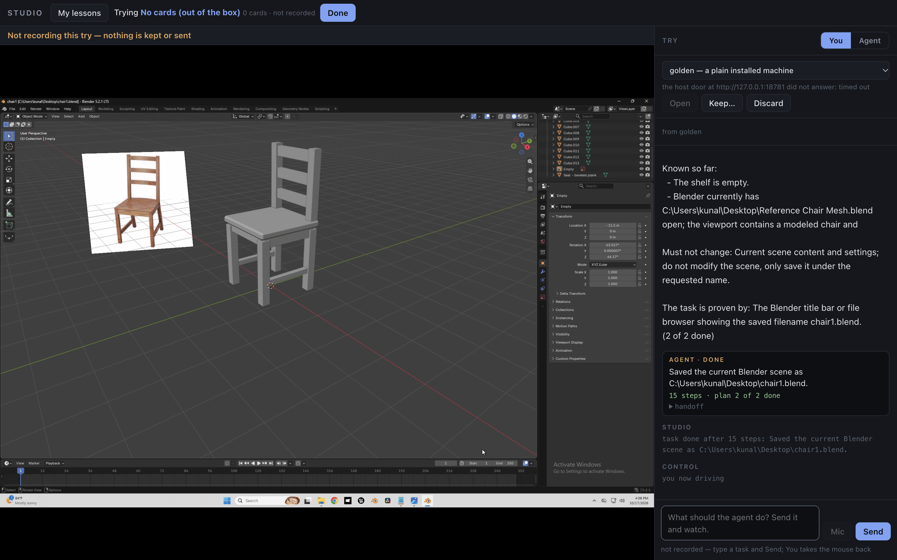

# Deskhand

A computer-use agent that works the Windows machine it runs on. Give it a task
in plain words ("Add a UV sphere to the scene", "save a picture of a brown dog
from Google Images into this folder") and it looks at the screen, clicks and
types until the task is done.

## Demo

**Video:** [the agent downloads VS Code and installs extensions on it, in about
10 minutes](https://drive.google.com/file/d/1jukmMj0_ECdQMZ_0fl48cMe23N8UBxRk/view)



*An agent run in Blender, in StudioApprentice's Studio app: asked to save the
open chair scene under a new name, the agent saved it as `chair1.blend` in 15
steps without changing the scene.*

## How it works

It is built on [StudioApprentice](https://github.com/KunalMGupta) perception
and tools:

```
screenshot
  -> perception: L0/L1 detectors (RF-DETR), OCR (PP-OCR), icon matching
                 run as three local servers on the GPU (scripts/stack.py)
  -> areas and region names: an OpenAI model (StudioApprentice's groups.py / view.py)
  -> tools: screen / focus / viewport / click / drag / scroll / type_text / key
            (studio's mcp_server, run in-process)
  -> brain: OpenAI Responses API, gpt-6-sol by default (scripts/cua_agent.py)
  -> input: real Windows mouse and keyboard events
```

**Safety:** with `--launch`, the agent starts its own Blender or Chrome
(Chrome with a throwaway profile), and input may only reach that process and
its children. Clicks or keys aimed at any other window are refused.

## Setup

Not in this repo, fetched separately:

| path | what |
|---|---|
| `repos/StudioApprentice-perception` | StudioApprentice perception code |
| `repos/studio` | StudioApprentice studio code (for `mcp_server/`) |
| `weights/l0`, `weights/l1` | detector checkpoints with `registry_row.json` and `ddp_spec.json` |
| `icon-library/` | icon library; `live` points at the version in use |
| `models-ocr/en_PP-OCRv3_rec_infer.onnx` | English OCR model, from [RapidOCR](https://huggingface.co/SWHL/RapidOCR) |

```powershell
python -m venv .venv
.venv\Scripts\pip install torch torchvision --index-url https://download.pytorch.org/whl/cu128
.venv\Scripts\pip install -r requirements.txt
.venv\Scripts\pip install --no-deps -e repos\StudioApprentice-perception
```

Put `OPENAI_API_KEY=...` in `.env` (or set it in the environment).

## Use

```powershell
.venv\Scripts\python scripts\stack.py up       # start the perception servers
.venv\Scripts\python scripts\cua_agent.py "Add a UV sphere to the scene." --launch blender --close
.venv\Scripts\python scripts\cua_agent.py "Search Google Images for dog and save a brown dog to C:\tmp as dog" --launch chrome --close
.venv\Scripts\python scripts\run_suite.py      # 8 Blender tasks, one fresh Blender each
.venv\Scripts\python scripts\stack.py down
```

Each run writes `runs/agent/<time>-<task>/`: every tool call (`steps.jsonl`),
the pictures the model saw, before/after screenshots and `result.json`.

The session must be **active**: over RDP, keep the client window open, because
a minimised or disconnected session has no screen to see or click.

## Results so far

8/8 basic Blender tasks (each checked by eye) at about 85 s and 14 steps
each, and one Chrome download task (49 steps, 7 min). Long tasks are still
expensive, because every picture stays in the conversation.
